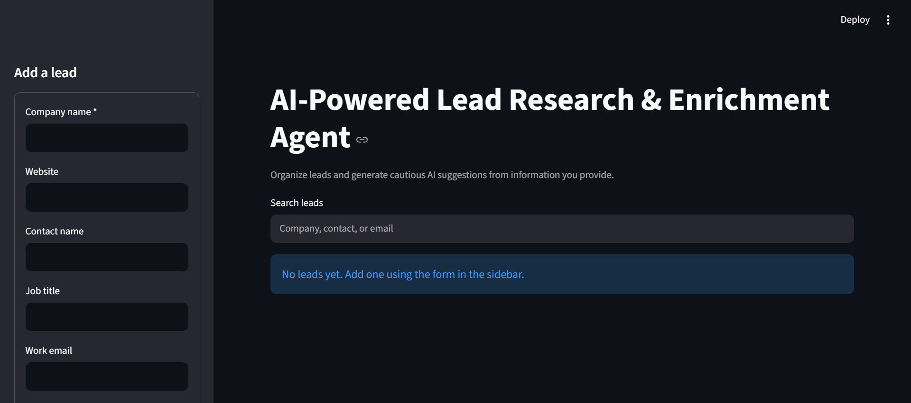
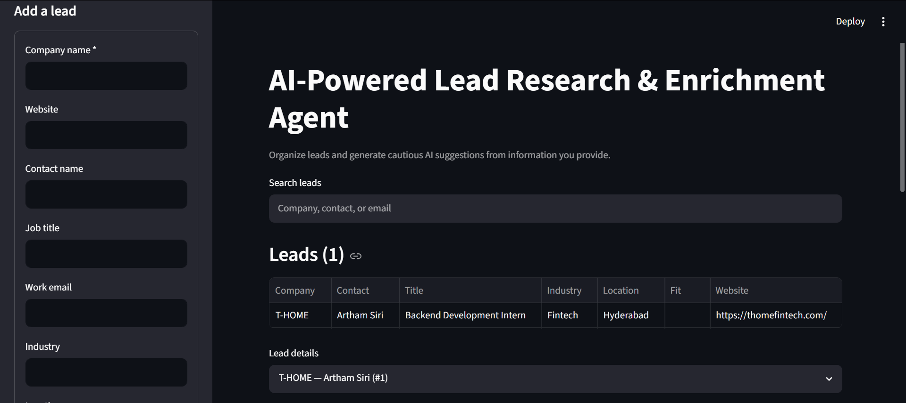

# Lead Research Agent

An AI-assisted lead management app built with Streamlit. Store leads in SQLite and optionally generate a cautious AI summary, suggested industry/location, and fit score from research notes you provide.

The AI does not browse the web or verify claims. Review suggestions and check reliable sources before treating them as facts.

# Lead Research Agent

**[🚀 Live Demo](https://lead-research-agent-xxntz23j85mz9cz2rwgtxh.streamlit.app/)**


## Features

- Add, browse, search, edit, and delete leads.
- Save lead records in SQLite.
- Generate structured AI suggestions through an OpenAI-compatible chat-completions API.
- Run core lead-management features without configuring AI.

## Run locally

```powershell
git clone https://github.com/Siriartham/lead-research-agent.git
cd lead-research-agent
py -m venv .venv
.\.venv\Scripts\Activate.ps1
python -m pip install -r requirements.txt
Copy-Item .env.example .env
streamlit run app.py
```

For local AI enrichment, put your provider settings in `.env`:

```dotenv
AI_API_KEY=
AI_BASE_URL=https://generativelanguage.googleapis.com/v1beta/openai/
AI_MODEL=gemini-3.8-flash
```

## Tests

```powershell
python -m unittest discover -s tests -v
```

GitHub Actions runs the unit tests on pushes and pull requests to `main`.

## 📸 Screenshots

### Dashboard


### Add Lead


### AI Enrichment


## Important limitations

- The app has no authentication. Anyone with access to the deployed URL can use it; do not enter sensitive lead or contact information.
- Streamlit Community Cloud's local filesystem is not durable. SQLite data can be lost after restarts or redeployments. Use a hosted database with access controls before relying on saved leads.
- Only use research data you are authorized to process, and follow provider terms and applicable privacy rules.
